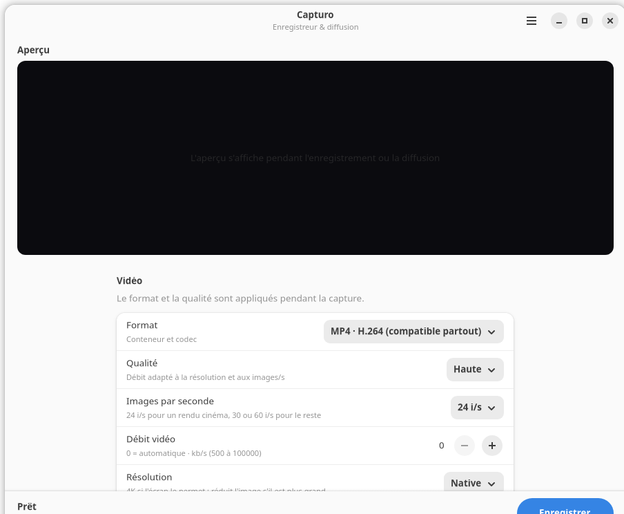

# Capturo

Enregistreur **et diffuseur** d'écran pour GNOME, en Python + GTK 4 /
libadwaita, empaqueté en `.deb`. Il capture un écran ou une fenêtre via le
portail ScreenCast de GNOME (donc Wayland **et** X11), peut incruster la
webcam, encode la vidéo avec GStreamer, écrit un fichier local et/ou
diffuse en direct en RTMP.



## Formats et qualité

| Format | Codec vidéo | Audio | Usage |
| --- | --- | --- | --- |
| MP4 | H.264 | AAC | Compatible partout, requis pour le streaming |
| MKV | H.265/HEVC | AAC | Fichiers plus petits à qualité égale |
| WebM | VP9 | Opus | Format libre, idéal pour le web |

Qualité : Basse, Moyenne, Haute, Très haute. Le débit est calculé à partir
de la résolution réelle, des images/s et du niveau choisi (par exemple
environ 7,5 Mbit/s en 1080p30 « Moyenne », 18 Mbit/s en « Très haute »).

Autres réglages : **24, 30 ou 60 i/s**, résolution native, **4K**, 1440p,
1080p, 720p ou 480p, microphone et/ou son du système. Le **débit vidéo**
peut être laissé automatique (0) ou fixé manuellement entre 500 et
100 000 kb/s pour l'enregistrement.

L'**encodeur** se choisit en Auto, Logiciel ou Matériel. En mode Auto,
Capturo utilise VA-API (`vah264enc`/`vah265enc`) ou NVENC
(`nvh264enc`/`nvh265enc`) s'il est disponible, puis retombe sur x264, x265
ou VP9. Le mode Matériel force la tentative et affiche le repli dans le
journal.

Le **MP4 fragmenté** écrit un index toutes les secondes : un fichier
interrompu reste lisible. À la fin de chaque capture, Capturo vérifie le
résultat avec `gst-discoverer-1.0` et signale un fichier vide, incomplet ou
sans piste lisible.

## Aperçu, webcam et compte à rebours

- **Aperçu en direct** : la capture est affichée dans la fenêtre pendant
  l'enregistrement ou la diffusion, avec un badge `REC` / `EN DIRECT`.
  L'aperçu est un flux 640×360 à faible débit pour ne pas pénaliser
  l'encodage. Il peut être désactivé (**Aperçu en direct**) pour économiser
  du processeur, surtout en 4K.
- **Réduction et notification** : Capturo peut se réduire au démarrage de
  l'enregistrement. Une notification propose **Arrêter** et **Afficher** ;
  la fenêtre revient automatiquement à la fin.
- **Caméra** : incrustation dans un coin (bas droite/gauche, haut
  droite/gauche), taille Petite/Moyenne/Grande, cadre **rectangle**,
  **carré** ou **rond**, et option Miroir. Les caméras locales sont
  détectées au lancement et via le bouton **Rechercher**.
- **Caméra réseau** : source **Caméra réseau (URL)** acceptant un flux
  MJPEG HTTP (`http://…/video`), RTSP (`rtsp://…`) ou **Capturo Webcam**
  (Wi-Fi/USB), sans module noyau.
- **Compte à rebours** : Aucun, 3, 5 ou 10 secondes entre la validation de
  l'écran par GNOME et le début de la capture. Le bouton devient
  **Annuler** pendant le décompte.
- **Dossier** : par défaut `~/Vidéos`, modifiable via **Choisir…**,
  réinitialisable avec **Par défaut**.

La fonction **pause/reprise a été supprimée** : le bouton arrête
directement l'enregistrement.

## Audio

- **Microphone** : interrupteur général, puis choix de l'**entrée micro**
  parmi les périphériques détectés (les moniteurs de sortie et sources
  factices sont filtrés). Le bouton ↻ relance la détection.
- **Volumes** : micro et son du système de **0 à 200 %**, appliqués avant
  le mixage.
- **Décalage du micro** : de **-500 à +500 ms** pour synchroniser une
  source retardée.
- **Vumètre** : pendant la capture, une barre suit le niveau du mixage.
- **Son du système** : capture du moniteur par défaut via PipeWire/PulseAudio.
- **Micro du téléphone** : `/audio` de Capturo Webcam, mixé avec les autres
  sources.

## Destination et fichiers

Le **dossier de destination** est modifiable et réinitialisable. Capturo
affiche l'**espace libre** et une **estimation de la taille par minute**
selon la résolution, les i/s, la qualité et le débit. Un enregistrement est
refusé s'il reste moins de **300 Mo**.

Le **modèle de nom de fichier** accepte les codes date/heure :
`%Y` année, `%m` mois, `%d` jour, `%H` heure, `%M` minute, `%S` seconde.
Exemple : `Capture_%Y-%m-%d_%H-%M-%S`. L'extension est ajoutée
automatiquement et un suffixe `_1`, `_2`… évite d'écraser un fichier
existant.

## Raccourcis

| Raccourci | Action |
| --- | --- |
| `Ctrl+R` | Démarrer ou arrêter l'enregistrement |
| `Échap` | Annuler le compte à rebours |
| `Ctrl+Q` | Quitter Capturo |

## Diffusion en direct (RTMP)

Le groupe **Diffusion en direct** propose trois modes :

1. **Enregistrement** : fichier local uniquement.
2. **Streaming RTMP** : diffusion seule, sans fichier local.
3. **Enregistrement + streaming** : une seule passe d'encodage H.264/AAC
   alimente le fichier MP4 et le flux RTMP.

Renseigne l'**URL RTMP** et, si elle ne contient pas la clé, la **clé de
diffusion**. Le menu **Plateforme** préremplit les adresses usuelles :

- Twitch : `rtmp://live.twitch.tv/app/`
- YouTube : `rtmp://a.rtmp.youtube.com/live2/`

Le **débit de diffusion** se règle entre 1 000 et 20 000 kb/s (4 500 kb/s
par défaut, adapté au 1080p). En diffusion, le format est forcé en
**MP4/H.264/AAC** ; en mode simultané, le fichier local reprend le même
flux (donc le même débit). Le bouton principal devient **Diffuser** ou
**Enreg. + direct**.

La clé de diffusion est conservée dans le **trousseau GNOME** via
libsecret (`gir1.2-secret-1`). Si le trousseau est indisponible ou
verrouillé, Capturo retombe sur `~/.config/capturo/config.json` ; protège
alors ce fichier. La clé n'est jamais réécrite en clair quand le trousseau
fonctionne.

## Lecteur vidéo après l'enregistrement

Capturo détecte les lecteurs **et** les éditeurs installés sur
l'ordinateur. Côté lecteurs : VLC, Showtime, Vidéos (Totem), Celluloid,
Haruna, Clapper, MPV, SMPlayer, Dragon Player, Parole… Côté éditeurs :
Kdenlive, Shotcut, Pitivi, OpenShot, Avidemux, LosslessCut, Flowblade,
Olive, Lightworks, Cinelerra, DaVinci Resolve et Blender. La détection
couvre les commandes natives, Flatpak, Snap, les AppImage et les lanceurs
`.desktop` ; les doublons Flatpak et les lecteurs de musique sont écartés.

Dans **Lecture et montage**, choisis directement le lecteur ou l'éditeur
dans la liste des applications détectées, ou clique sur **Choisir…** pour
parcourir **toutes** les applications vidéo installées (natives, Flatpak,
Snap) : la sélection se fait dans la liste des applications, sans saisir
de commande. Le bouton **Parcourir…** de cette fenêtre permet en plus de
désigner un exécutable ou un fichier `.desktop` précis, par exemple une
AppImage. Le bouton ↻ relance la détection. À la fin d'un enregistrement
fichier, Capturo demande **« Ouvrir la vidéo ? »** et lance le fichier
avec l'application choisie si tu acceptes.

## Apparence

- **Thème** : Automatique (suit GNOME), Clair ou Sombre.
- **Couleur des boutons** : Bleu, Violet, Rose, Rouge, Orange, Jaune,
  Vert, Turquoise ou Gris.

Ces réglages sont appliqués immédiatement et mémorisés.

## Utiliser un téléphone comme webcam

### Capturo Webcam (Android, recommandé)

L'application **Capturo Webcam** diffuse la caméra et le micro du
téléphone en HTTP (MJPEG + PCM). Dans Capturo :

1. Lancer Capturo Webcam sur le téléphone.
2. Connecter le téléphone au même Wi-Fi, ou activer le **partage de
   connexion USB** dans les réglages Android (ce n'est pas un bouton de
   l'application).
3. Dans Capturo : **Caméra** → **Source** → **Caméra réseau (URL)**.
4. Cliquer sur **Détecter** : Capturo interroge le réseau, y compris
   l'interface USB, et remplit l'adresse automatiquement. La détection est
   aussi tentée au démarrage et au changement de source.
5. Activer **Incruster la caméra** et, si besoin, **Micro du téléphone**
   (le son est récupéré sur `/audio`).

**Nouveautés 2.1** :

- **Jeton d'accès** : dans les réglages du téléphone, un jeton protège
  `/video` et `/audio`. Sans jeton, le flux reste ouvert sur le réseau
  local ; avec un jeton, l'adresse affichée et le **QR** contiennent
  `?token=…`. Capturo reprend ce jeton lors de la détection Wi-Fi/USB.
- **QR de l'adresse** : bouton QR dans **Connexion** pour scanner l'URL
  complète depuis un autre appareil.
- **Torche** : interrupteur disponible quand la caméra choisie a un flash.
- **Images par seconde** : 15, 24, 30 ou 60 i/s, avec plafonnement
  automatique en 4K/1080p pour ne pas surcharger le téléphone.
- **Maintien éveillé** : l'écran reste allumé quand la diffusion tourne et
  une veille partielle garde le service actif écran éteint.

**USB avec adb** : Capturo détecte automatiquement le téléphone branché
en USB si `adb` est installé et si le débogage USB est autorisé. Il crée
lui-même le transfert nécessaire et utilise
`http://127.0.0.1:8080/video` :

```bash
adb devices                    # vérifie que le téléphone est autorisé
adb forward --list             # Capturo ajoute tcp:8080 automatiquement
```

Avec un jeton, la détection locale par adb ne peut pas le deviner :
recopie l'adresse complète affichée sur le téléphone (ou scanne le QR) dans
le champ **Caméra réseau (URL)**.

Aucune commande n'est à lancer à la main. Si `adb` n'est pas disponible,
le **partage de connexion USB** (adresse `192.168.42.x`) ou le Wi-Fi
restent utilisables.

### Webcam UVC native (Android 14+)

1. Brancher le téléphone en USB et le déverrouiller.
2. Ouvrir la notification « Chargement via USB » puis choisir
   **Webcam** / **Utiliser comme webcam**.
3. Vérifier côté PC : `ls /dev/video*`.
4. Dans Capturo, cliquer sur **Rechercher** puis activer
   **Incruster la caméra**.

### Autre application MJPEG/RTSP

Utiliser par exemple *IP Webcam*, puis saisir l'adresse affichée dans
**Caméra réseau (URL)**. Le flux est décodé par GStreamer
(`multipartdemux`/`jpegdec` pour MJPEG, `rtspsrc` pour RTSP).

## Utilisation

```bash
./run.sh          # depuis les sources
```

1. Choisir le mode (enregistrement, streaming ou les deux), le format, la
   qualité, les images/s, la résolution, la caméra et l'audio.
2. Cliquer sur **Enregistrer** / **Diffuser** (ou `Ctrl+R`).
3. GNOME demande quel écran ou quelle fenêtre capturer.
4. Le compte à rebours s'affiche, puis la capture démarre ; l'aperçu
   apparaît dans la fenêtre.
5. Cliquer sur **Arrêter** : le fichier est finalisé, la diffusion est
   coupée, une notification annonce le fichier et Capturo propose de
   l'ouvrir dans le lecteur ou l'éditeur choisi.

Les réglages sont mémorisés dans `~/.config/capturo/config.json`.

## Structure du projet

```
capturo/
├── capturo/                  # code de l'application
│   ├── __init__.py           # identifiant et version
│   ├── __main__.py           # « python3 -m capturo »
│   ├── app.py                # application GTK, actions, raccourcis
│   ├── window.py             # interface et orchestration
│   ├── portal.py             # client du portail ScreenCast
│   ├── recorder.py           # pipeline GStreamer (formats, streaming, audio)
│   ├── credentials.py        # clé RTMP dans le trousseau (libsecret)
│   ├── discovery.py          # découverte Wi-Fi/USB de Capturo Webcam
│   ├── diagnostics.py        # journal ~/.cache/capturo/capturo.log
│   ├── editors.py            # détection des lecteurs et éditeurs vidéo
│   ├── i18n.py               # initialisation gettext
│   └── settings.py           # préférences JSON
├── data/                     # ressources installées
│   ├── capturo               # lanceur Debian (/usr/lib) et Flatpak (/app/lib)
│   ├── io.github.yannick.Capturo.desktop
│   ├── io.github.yannick.Capturo.svg
│   ├── io.github.yannick.Capturo.metainfo.xml
│   └── screenshots/          # captures pour le README
├── flatpak/                  # manifeste et notice Flatpak
│   ├── io.github.yannick.Capturo.json
│   └── README.md
├── po/                       # traductions gettext (capturo.pot, *.po)
├── tests/
│   └── test_pipeline.py      # test GStreamer headless pour la CI
├── .github/workflows/ci.yml  # validation, test et paquet Debian
├── packaging/                # fichiers Debian
│   ├── control               # métadonnées + dépendances
│   ├── postinst / postrm     # scripts de maintenance
│   ├── copyright
│   └── changelog
├── build.sh                  # construit dist/capturo_1.6.2_all.deb
└── run.sh
```

## Construire et installer le paquet

```bash
./build.sh
sudo apt install ./dist/capturo_1.6.2_all.deb
```

`apt` installe les dépendances manquantes (GStreamer, portail GNOME…).
Le script compile aussi les traductions `po/*.po` dans
`/usr/share/locale` et vérifie la syntaxe Python avant de créer l'archive.

Vérifications utiles :

```bash
dpkg-deb --info dist/capturo_1.6.2_all.deb
dpkg-deb --contents dist/capturo_1.6.2_all.deb
dpkg -L capturo
capturo          # lancement depuis le menu ou le terminal
sudo apt remove capturo
```

## Flatpak et CI

Le manifeste `flatpak/io.github.yannick.Capturo.json` cible le runtime
GNOME 48 et réutilise les extensions GStreamer de Freedesktop. Il autorise
le portail ScreenCast, PulseAudio, le réseau, `~/Vidéos`, la configuration,
le cache et le trousseau :

```bash
flatpak-builder --user --install --force-clean build-flatpak \
  flatpak/io.github.yannick.Capturo.json
flatpak run io.github.yannick.Capturo
```

Les détails (extensions VA-API/NVENC, dépannage) sont dans
`flatpak/README.md`. Sans les extensions, Capturo utilise le repli
logiciel.

Le workflow `.github/workflows/ci.yml` vérifie à chaque envoi :

- la syntaxe Python (`compileall`) ;
- la validité AppStream et du lanceur `.desktop` ;
- le pipeline GStreamer headless (`tests/test_pipeline.py`) ;
- la construction du paquet Debian, publié comme artefact.

Le test local équivalent :

```bash
python3 -m compileall -q capturo tests
appstreamcli validate data/io.github.yannick.Capturo.metainfo.xml
desktop-file-validate data/io.github.yannick.Capturo.desktop
python3 tests/test_pipeline.py
```

## Comment ça marche

1. `portal.py` ouvre une session `org.freedesktop.portal.ScreenCast` :
   `CreateSession` → `SelectSources` → `Start` → `OpenPipeWireRemote`.
   GNOME affiche son sélecteur d'écran/fenêtre et renvoie un descripteur
   de fichier PipeWire.
2. `recorder.py` construit une ligne `gst_parse_launch` :
   `pipewiresrc fd=… path=… ! videoconvert ! videorate ! videoscale !
   capsfilter ! tee name=preview_tee`, avec une branche d'aperçu
   `appsink` 640×360 et une branche d'encodage. Avec la caméra, les deux
   flux passent par `compositor` (écran sur `sink_0`, webcam recadrée sur
   `sink_1`). Le cadrage rond utilise `alphacombine` et un masque PNG
   circulaire, car `cairooverlay` n'est pas disponible sans
   `python3-gi-cairo`. Le masque et la caméra sont négociés en plage
   complète (0–255) : les coins sont vraiment transparents et la webcam
   reste opaque.
3. En streaming, l'encodeur H.264/AAC alimente un `tee` : une branche va
   vers `mp4mux`/`filesink`, l'autre vers `flvmux`/`rtmpsink`. En
   diffusion seule, seul le second chemin existe. Un `queue` sur chaque
   branche évite les blocages.
4. À l'arrêt, un EOS est envoyé au pipeline pour finaliser proprement le
   fichier (surtout pour MP4/WebM) et la session du portail est fermée.
   Si le muxeur ne répond pas, la remise à NULL est faite dans un fil
   d'arrière-plan après 3 s, puis un garde-fou de 6 s évite tout blocage
   de la fenêtre. Fermer Capturo depuis la barre des tâches pendant un
   enregistrement reste donc fluide.

## Personnaliser

- **Nom / identifiant** : `APP_ID` dans `capturo/__init__.py`, noms de
  fichiers dans `data/` et références dans `build.sh`.
- **Version** : `VERSION` dans `build.sh`, `__version__`, et
  `packaging/changelog`.
- **Nouveaux formats** : `FORMAT_IDS`, `FORMAT_LABELS`,
  `_video_encoder()`, `_muxer()` et `_audio_suffix()` dans
  `recorder.py`.
- **Caméra** : `CAMERA_POSITIONS`, `CAMERA_SIZES`,
  `CAMERA_SIZE_FRACTIONS` et `_camera_box()` dans `recorder.py`.
- **Lecteurs / éditeurs** : `KNOWN_PLAYERS`, `KNOWN_EDITORS`,
  `FLATPAK_PLAYERS` et `FLATPAK_EDITORS` dans `editors.py`.
- **Couleurs d'accent** : `ACCENTS` dans `window.py`.
- **Dépendances** : champ `Depends:` dans `packaging/control`.

## Dépannage

- **Aucune fenêtre de sélection** : vérifier que
  `xdg-desktop-portal-gnome` est installé et que la session est GNOME.
  `systemctl --user restart xdg-desktop-portal` peut aider.
- **Écran noir / flux vide** : certains pilotes ou sessions X11 anciens
  posent problème ; tester avec une capture de fenêtre.
- **Pas de son système** : le moniteur `@DEFAULT_MONITOR@` dépend de
  PipeWire/PulseAudio ; vérifier avec
  `gst-launch-1.0 pulsesrc device=@DEFAULT_MONITOR@ ! fakesink`.
- **Caméra absente** : vérifier `gst-device-monitor-1.0 Video/Source` et
  `ls /dev/video*`. L'option est grisée quand aucune caméra n'est vue au
  lancement ; relancer Capturo après avoir branché la webcam.
- **Streaming refusé** : vérifier l'URL `rtmp://`, la clé, et que les
  greffons `rtmpsink`/`flvmux` sont présents
  (`gst-inspect-1.0 rtmpsink flvmux`). Le paquet dépend de
  `gstreamer1.0-plugins-bad`.
- **Lecteur ou éditeur absent de la liste** : cliquer sur **Choisir…**
  pour parcourir toutes les applications vidéo installées, ou sur
  **Parcourir…** pour désigner directement un exécutable / une AppImage.
  Le bouton ↻ relit les lanceurs `.desktop`, Flatpak et Snap.
- **Fermeture pendant un enregistrement** : Capturo arrête la capture,
  finalise le fichier puis se ferme. En cas de périphérique qui ne répond
  plus, un garde-fou termine le processus au bout de quelques secondes.
  Le détail est écrit dans `~/.cache/capturo/capturo.log`, ouvrable depuis
  le menu **Ouvrir le journal**.
- **Fichier illisible après un arrêt brutal** : MP4 et WebM ont besoin de
  l'EOS ; Capturo l'envoie à l'arrêt, attends le message « Vidéo
  enregistrée ».

## Notes de packaging

- Le paquet Debian utilise `Architecture: all` : que du Python et des
  ressources, pas de binaire compilé.
- Le lanceur `data/capturo` cherche le module dans `/app/lib` (Flatpak)
  puis `/usr/lib` (Debian), ce qui permet de partager le même fichier.
- `gir1.2-secret-1`, `gstreamer1.0-vaapi` et `gstreamer1.0-tools` sont
  seulement recommandés : Capturo fonctionne sans eux (clé RTMP en clair,
  encodage logiciel, vérification désactivée).
- Le manifeste Flatpak est fourni pour les tests ; la version publiée reste
  le `.deb`. Les extensions GStreamer de Freedesktop sont nécessaires pour
  les codecs non inclus dans le runtime GNOME.
- Pour un paquet compilé, passer `ARCH` à `amd64` et ajouter l'étape de
  compilation dans `build.sh`.
- Penser à mettre à jour `packaging/changelog`, `capturo/__init__.py`,
  `build.sh` et la section `<releases>` de la métadonnée AppStream à chaque
  version.
